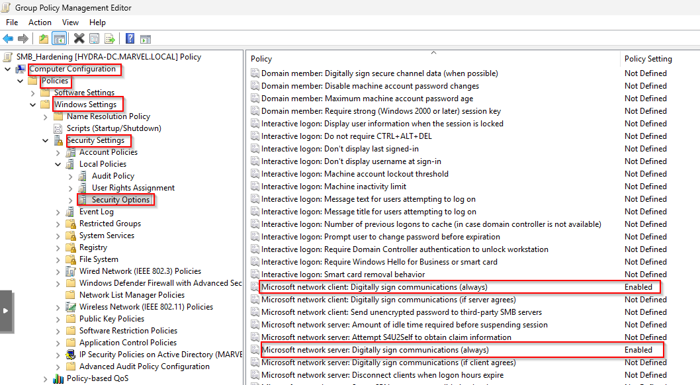
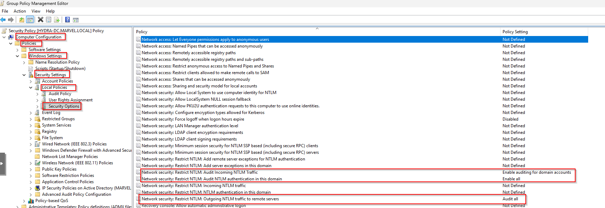
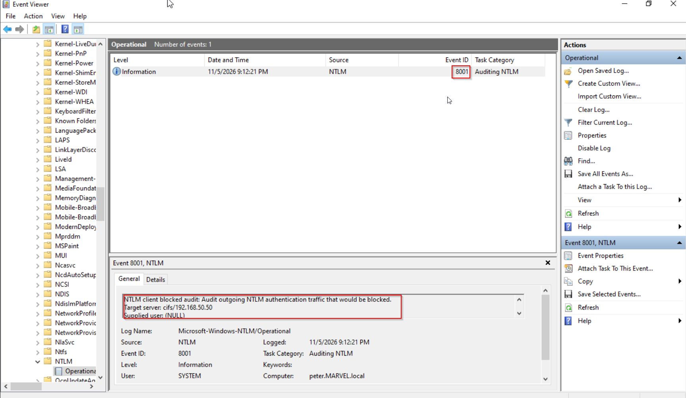

# SMB Hardening

## Overview

Server Message Block (SMB) is a network protocol used by Windows systems for sharing files, printers, and other network resources.

One security risk involving SMB is **SMB Relay**, where an attacker captures or intercepts NTLM authentication traffic and relays it to another system to gain unauthorized access.

This documentation covers four mitigation strategies to reduce the risk of SMB Relay attacks and limit unauthorized access within the Active Directory environment.

## Lab Environment

| Component | Configuration |
|---|---|
| Domain | `MARVEL.LOCAL` |
| Domain Controller | `HYDRA-DC` |
| OU | `Workstations` |
| Workstation 1 | `HEAVEN` |
| Workstation 2 | `PETER` |
| Operating System | Windows 10 Pro 22H2 |

## Mitigation Strategies

### 1. Enable SMB Signing on All Devices

**Objective:** Require SMB signing on client and server devices to help prevent SMB Relay attacks.

SMB Signing uses a digital signature to verify the integrity and authenticity of SMB messages. Requiring SMB Signing makes it harder for attackers to relay authentication to systems that enforce signing.

**Configuration through Group Policy:**

1. Open Group Policy Management using `gpmc.msc`.
2. Create a new GPO named `SMB Signing Hardening` or configure your existing GPO.
3. Link the GPO to the `Workstations` OU.
4. Edit the GPO and navigate to:

   `Computer Configuration > Policies > Windows Settings > Security Settings > Local Policies > Security Options`

5. Enable the following policies:

   - `Microsoft network client: Digitally sign communications (always)`
   - `Microsoft network server: Digitally sign communications (always)`



6. Apply the policy on the target workstations:

   ```powershell
   gpupdate /force
   ```

**Verification:**

Run these commands in PowerShell:

```powershell
Get-SmbClientConfiguration | Select-Object RequireSecuritySignature

Get-SmbServerConfiguration | Select-Object RequireSecuritySignature
```

Expected result:

```text
RequireSecuritySignature
------------------------
True
```

Both client and server configurations should require SMB signing.

**Security Consideration:**

Enabling SMB Signing may affect performance, especially during file transfers. Older devices or applications may also have compatibility issues.

### 2. Disable NTLM Authentication on the Network

**Objective:** Reduce the risk of NTLM-based authentication relay attacks by restricting or disabling NTLM authentication where possible.

NTLM is an older Windows authentication protocol. Attackers may abuse NTLM authentication exchanges to perform relay attacks.

**Configuration through Group Policy:**

1. Open Group Policy Management using `gpmc.msc`.
2. Create a GPO named `NTLM Authentication Restriction` or using the existing GPO.
3. Link it to the appropriate OU or domain scope.
4. Navigate to:

   `Computer Configuration > Policies > Windows Settings > Security Settings > Local Policies > Security Options`

5. Review the available policies under **Network security: Restrict NTLM**.



**Verification:**

Review the NTLM Operational log:

`Event Viewer > Applications and Services Logs > Microsoft > Windows > NTLM > Operational`



Check for NTLM authentication activity and identify systems that still use the protocol.

**Security Consideration:**

Disabling NTLM without proper testing may break authentication for systems and applications that do not support Kerberos. Windows may fall back to NTLM when Kerberos authentication is unavailable, so dependencies must be identified before enforcement.

### 3. Account Tiering

**Objective:** Limit the use of privileged accounts and prevent Domain Admin credentials from being exposed on ordinary workstations.

Account Tiering separates accounts based on their privilege levels. Domain Admin accounts should only be used for tasks that require domain-level administrative access.

**Recommended Practices:**

- Use standard domain accounts for everyday activities.
- Reserve Domain Admin accounts for domain administration.
- Avoid logging in with Domain Admin accounts on regular workstations.
- Restrict privileged account logon access to designated administrative systems.
- Use separate accounts for administrative and normal activities.

**Configuration Considerations:**

Use Group Policy to configure user rights assignments and logon restrictions for privileged accounts.

Review these policies:

`Computer Configuration > Policies > Windows Settings > Security Settings > Local Policies > User Rights Assignment`

Relevant policies include:

- Allow log on locally
- Allow log on through Remote Desktop Services
- Deny log on locally
- Deny log on through Remote Desktop Services

Apply restrictions carefully to avoid locking out legitimate administrators.

**Security Consideration:**

Account Tiering helps reduce the exposure of privileged credentials. However, enforcing the policy requires proper planning, account separation, and administrative procedures.

### 4. Local Administrator Restriction

**Objective:** Limit local administrator privileges to reduce unauthorized administrative access and lateral movement between workstations.

Local administrator accounts have elevated privileges on individual computers. If attackers compromise an account with local administrator access, they may use those privileges to move to other systems.

**Recommended Practices:**

- Limit the number of users with local administrator privileges.
- Avoid giving standard domain users local administrator access.
- Use dedicated administrative accounts when elevated privileges are required.
- Manage local administrator passwords securely.
- Regularly review local Administrators group membership.

**Configuration Considerations:**

Use Group Policy to manage local Administrators group membership.

Navigate to:

`Computer Configuration > Policies > Windows Settings > Security Settings > Restricted Groups`

Configure the local `Administrators` group and specify only the accounts or groups that should have administrative privileges.

Review the configuration carefully before applying it to workstations.

**Security Consideration:**

Restricting local administrator access can reduce lateral movement opportunities. However, users who legitimately require administrative privileges may need an approved alternative.

## Conclusion

SMB hardening involves more than enabling SMB Signing. Restricting NTLM authentication, implementing Account Tiering, and limiting local administrator privileges provide additional layers of protection.

These mitigation strategies help reduce SMB Relay risks, protect privileged credentials, and limit lateral movement within the Active Directory environment.

All configurations should be tested and verified before being considered fully implemented.

## References

- Microsoft Learn – SMB Security
- Microsoft Learn – Restrict NTLM
- Microsoft Learn – Group Policy Security Settings
- Microsoft Learn – Windows User Rights Assignment
