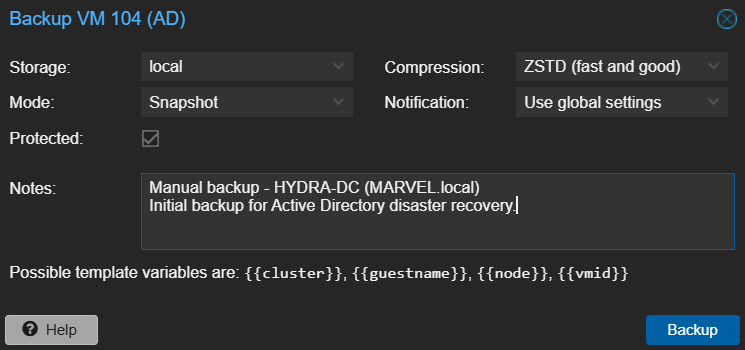
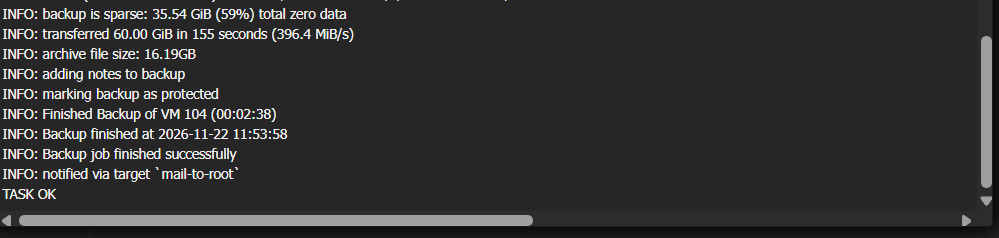
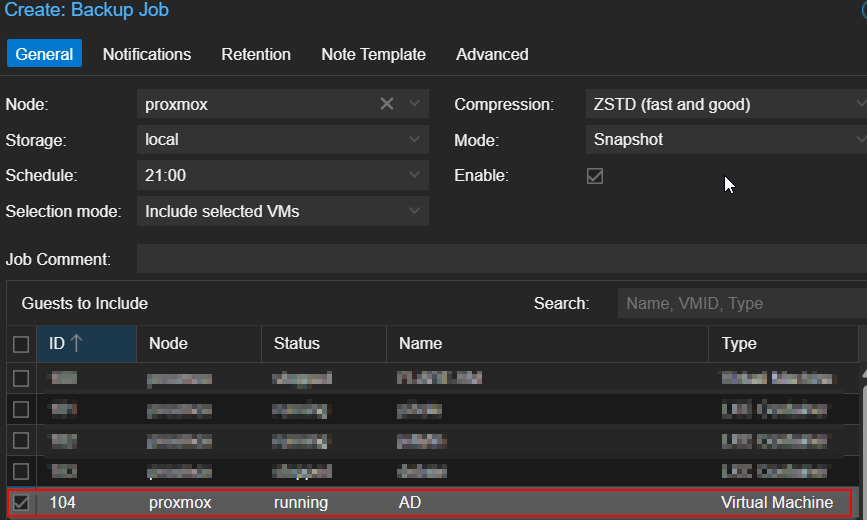
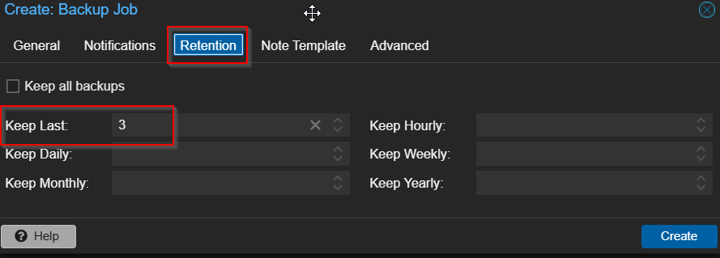
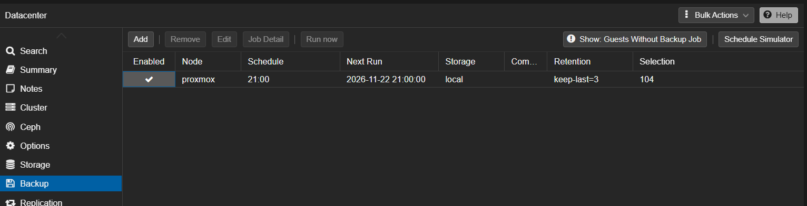
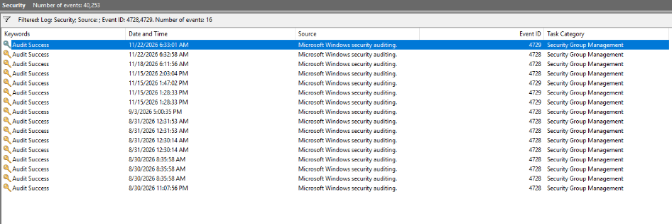
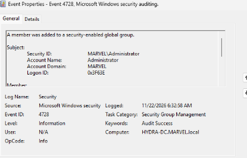
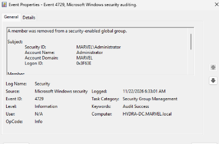

# Domain Controller Hardening

**Domain:** `MARVEL.LOCAL`  
**Domain Controller:** `HYDRA-DC.MARVEL.local`  
**VMID:** `104`  
**Operating System:** Windows Server 2025 Standard Evaluation  
**Build:** `26100`

This document records the implementation and verification of Active Directory hardening on the `HYDRA-DC` domain controller.

---

## Domain Controller OS and Service Hardening

### Objective

Reduce the attack surface of the Domain Controller by reviewing installed roles, removing unnecessary shares, and disabling unnecessary services.

### System Configuration

- Windows Server 2025 Standard Evaluation
- Build 26100
- Active Directory Domain Services
- DNS Server
- DHCP Server
- Active Directory Certificate Services
- File Server

AD DS, DNS, DHCP, and AD CS are intentionally retained for the lab environment.

### Service Hardening

The following services were verified as `Stopped` and `Disabled`:

| Service | Purpose |
|---|---|
| AudioEndpointBuilder | Windows audio infrastructure |
| Audiosrv | Windows Audio |
| CDPSvc | Connected Devices Platform |
| DiagTrack | Connected User Experiences and Telemetry |
| RemoteRegistry | Remote Registry |
| sshd | OpenSSH Server |
| WpnService | Windows Push Notifications |

### SMB Share Review

The custom shares below were removed:

- `hackme`
- `Hackmebro`

The remaining shares were:

- `ADMIN$`
- `C$`
- `IPC$`
- `NETLOGON`
- `SYSVOL`

The remaining administrative and domain shares are expected for normal Windows and Active Directory operation.

### Installed Role Review

The File Server role removal was attempted but failed because required shares were still present.

`FS-FileServer` was retained pending dependency review. The removal status of `System-DataArchiver` and `WindowsAdminCenterSetup` was not confirmed as successful.

### Result

**Status: Partially Completed**

Unnecessary services were disabled and custom shares were removed. Further review of optional installed roles remains necessary.

---

## Domain Controller Backup and Recovery

### Objective

Protect Active Directory against data loss and prepare for Domain Controller or forest recovery.

### Backup Environment

- Proxmox VE
- Domain Controller VMID: `104`
- VM: `HYDRA-DC`

### Backup Configuration











An initial manual Proxmox backup was created, and the resulting backup archive was verified.

A daily scheduled backup was configured for:

- Schedule: Daily
- Time: 21:00
- Target VM: `104 – HYDRA-DC`

### Verification Status

| Item | Status |
|---|---|
| Initial manual backup | Created |
| Backup archive | Verified |
| Daily scheduled backup | Configured |
| First scheduled execution | Pending verification |
| Offline backup copy | Not yet implemented |

### Offline Backup Plan

An external USB HDD/SSD is available for the planned offline backup process.

The intended process is:

1. Copy the Proxmox backup archive to the external drive.
2. Verify that the copied archive is accessible.
3. Safely eject the external drive.
4. Disconnect it from the Proxmox host.
5. Keep the backup disconnected when not in use.

This process remains pending implementation and verification.

### Result

**Status: Partially Completed**

An initial manual backup exists and a daily backup schedule is configured. Offline backup implementation, scheduled-run verification, and forest recovery rehearsal remain outstanding.

---

## Windows Event Forwarding (WEF)

### Objective

Centralize security event monitoring by forwarding selected Security events from the Domain Controller to a separate workstation.

### Configuration

**Source:** `HYDRA-DC.MARVEL.local`  
**Collector:** `AD-Heaven`  
**Subscription:** `HYDRA-DC-SECURITY`  
**Subscription Type:** Source Initiated  
**Destination Log:** `Forwarded Events`

The collector-initiated configuration was not used. The subscription was configured using source-initiated delivery.

### Subscription Verification

Command:

```powershell
wecutil gs HYDRA-DC-SECURITY
```

Verified results:

- Subscription ID: `HYDRA-DC-SECURITY`
- Subscription Type: `SourceInitiated`
- Runtime Status: `Active`
- Last Error: `0`

The source computer was also verified as active with no reported error.

### Event Forwarding Tests

The following events were generated and verified on the collector:

| Event ID | Description | Result |
|---|---|---|
| 4625 | Failed logon | Forwarded |
| 4728 | Member added to a security-enabled global group | Forwarded |
| 4729 | Member removed from a security-enabled global group | Forwarded |

Events 4728 and 4729 were tested using a temporary `audit_test` account/group membership operation.

### Log Locations

On the Domain Controller:

`Event Viewer → Windows Logs → Security`

On the collector:

`Event Viewer → Windows Logs → Forwarded Events`

### Result







**Status: Completed**

The source-initiated subscription is active, reports no error, and successfully forwards the tested Security events.

---

## Tier 0 Security Auditing

### Objective

Improve visibility over privileged Active Directory objects and detect changes to sensitive groups and directory permissions.

### Advanced Audit Policy

The following audit subcategories were enabled with Success and Failure auditing:

```powershell
auditpol /set /subcategory:"Security Group Management" /success:enable /failure:enable

auditpol /set /subcategory:"Directory Service Changes" /success:enable /failure:enable
```

Both settings were verified using `auditpol`.

### Protected Objects Reviewed

The following Tier 0 objects were configured for auditing:

- Domain Admins
- Enterprise Admins
- Schema Admins
- Domain Controllers OU
- AdminSDHolder

Explicit auditing entries were added for `Everyone` with the following rights:

- WriteProperty
- Delete
- WriteDacl
- WriteOwner

Audit flags:

- Success
- Failure

Inheritance was configured as `None` for the explicit object-level entries.

### SACL Verification

Example verification:

```powershell
$DN = "CN=Domain Admins,OU=Groups,DC=MARVEL,DC=local"

Get-Acl -Path "AD:\$DN" -Audit
```

The `-Audit` parameter is required to display the object's auditing rules.

### Functional Testing

A temporary `audit_test` membership change was performed against Domain Admins.

The following events were generated and verified:

- Event ID 4728 – Member added
- Event ID 4729 – Member removed

Both events were also successfully forwarded through WEF to the collector.

### Result

**Status: Completed**

Advanced auditing and explicit auditing entries were configured and verified on the selected Tier 0 objects. Group membership auditing was tested locally and through WEF.

---

## BloodHound Active Directory Attack Path Review

### Objective

Identify potential privilege escalation paths, excessive permissions, privileged sessions, and risky relationships in the Active Directory environment.

### Collection

BloodHound CE was used to collect and analyze the `MARVEL.LOCAL` domain.

A fresh collection was performed after the hardening changes, and the reviewed results remained consistent.

### User Attack Path Review

The following actual AD user accounts were reviewed:

| User | SamAccountName |
|---|---|
| Heaven Dimla | `hdimla` |
| Peter Parker | `PParker` |

Pathfinding checks were performed against:

- Domain Admins
- Enterprise Admins
- Schema Admins
- Administrators
- HYDRA-DC

**Result:** No paths were found for either user in the reviewed collection.

### Object Control Review

Inbound and outbound object-control relationships were reviewed for both users.

- No unexpected outbound object-control relationships were identified.
- Inbound permissions from privileged groups were observed and reviewed.
- No ordinary-user-to-Tier-0 attack path was identified in the reviewed pathfinding results.

The presence of an inbound relationship does not automatically mean it is exploitable. Permissions must be evaluated based on the source principal, rights, inheritance, and intended configuration.

### Local Administrators and Sessions

**HEAVEN.MARVEL.LOCAL**

Local Administrators included:

- Administrator
- hdimla
- tstark

No sessions were detected in the reviewed collection.

`hdimla` being a local administrator on the workstation is a workstation-level privilege and does not automatically grant Domain Admin privileges.

**Peter's workstation**

No unexpected local administrator relationships or sessions were detected in the reviewed collection.

### gMSA Review

BloodHound identified that `HEAVEN.MARVEL.LOCAL` has `ReadGMSAPassword` access to `GMSA-SQLSERVICE`.

The allowed retrieval principal was verified on the Domain Controller:

```powershell
Get-ADServiceAccount -Identity "GMSA-SQLSERVICE" -Properties PrincipalsAllowedToRetrieveManagedPassword |
Select-Object -ExpandProperty PrincipalsAllowedToRetrieveManagedPassword
```

The configured group was:

`gMSA-SQLService-Hosts`

This is an intentional configuration for the `HEAVEN$` computer account. It is not intended to grant password retrieval to the `hdimla` user account.

### Privileged Group Membership Review

The following groups were reviewed:

| Group | Members |
|---|---|
| Domain Admins | Administrator, tstark |
| Enterprise Admins | Administrator, tstark |
| Schema Admins | Administrator, tstark |
| Administrators | Administrator, tstark |
| Account Operators | No members returned |
| Enterprise Key Admins | No members returned |
| Key Admins | No members returned |

`tstark` is an intentionally privileged lab account.

### Tier 0 ACL Relationships

Inbound ACL relationships were also reviewed for:

- Domain Admins
- Enterprise Admins
- Schema Admins
- AdminSDHolder

The reviewed relationships involved privileged groups such as Administrators, Domain Admins, and Enterprise Admins.

These high-impact permissions should remain documented and periodically reviewed against the intended security baseline.

### Fresh Collection Verification

After a fresh BloodHound collection:

- The reviewed user attack paths remained unchanged.
- No new unexpected attack paths were identified.
- The reviewed object-control findings remained consistent.

### Result

**Status: Completed**

No unexpected attack paths were identified in the reviewed BloodHound collection. This does not prove that the domain is vulnerability-free; findings depend on collection coverage and the relationships BloodHound can analyze.

---

## Overall Assessment

| Check | Status |
|---|---|
| Domain Controller OS and Service Hardening | Partially Completed |
| Domain Controller Backup and Recovery | Partially Completed |
| Windows Event Forwarding | Completed |
| Tier 0 Security Auditing | Completed |
| BloodHound Attack Path Review | Completed |
