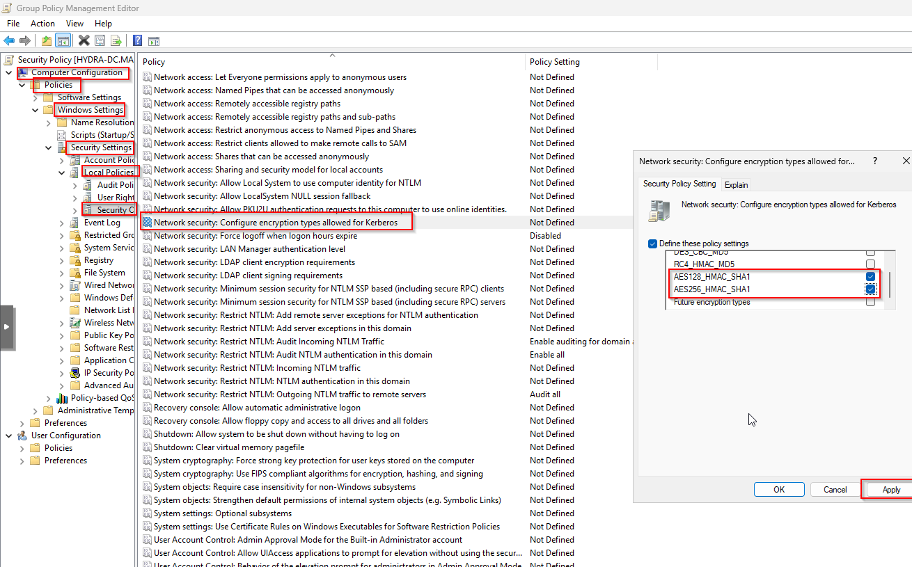
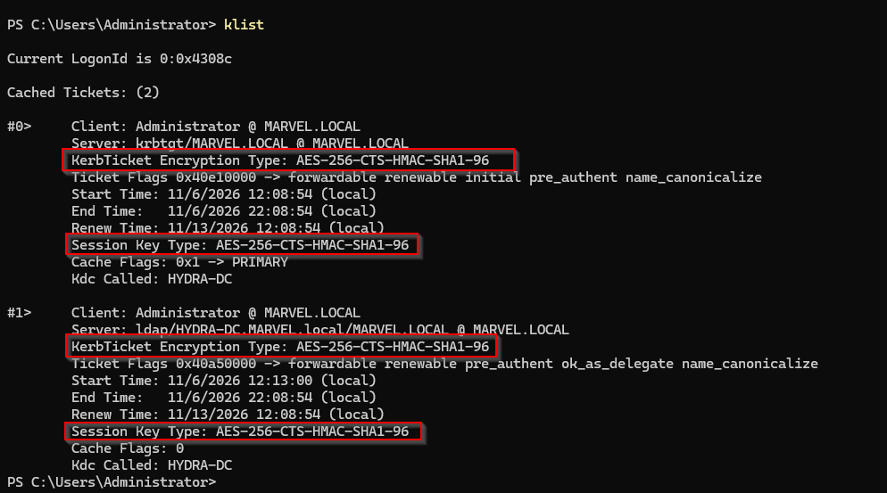
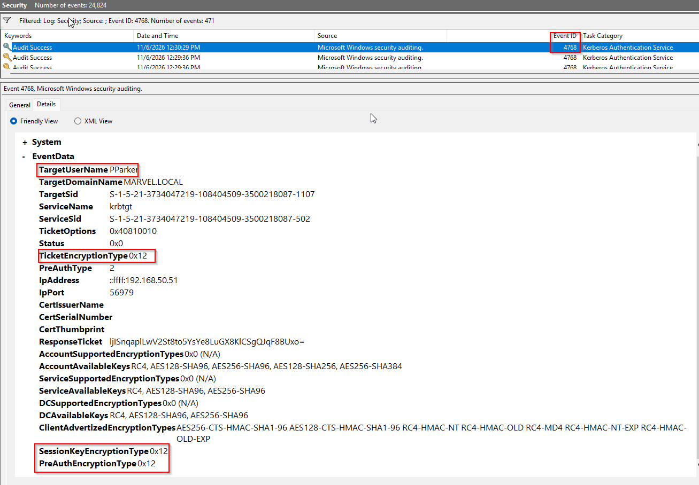

# Enforcing AES for Kerberos

## 1. Overview

This documentation covers the implementation and validation of AES encryption for Kerberos authentication in the `MARVEL.LOCAL` Active Directory environment.

The hardening process is based on Microsoft's Active Directory Hardening Series – Part 4: Enforcing AES for Kerberos.

The primary objective is to reduce the use of RC4-HMAC encryption and transition Kerberos authentication toward AES128 and AES256.

## 2. Objectives

- Understand the security risks associated with RC4 Kerberos encryption.
- Configure AES128 and AES256 for SPN-enabled service accounts.
- Audit Kerberos authentication using Windows Event Viewer.
- Identify accounts with missing AES keys.
- Identify clients and devices that still support or use RC4.
- Configure Group Policy to allow AES encryption and exclude RC4.
- Verify that Kerberos tickets are actually encrypted using AES256.

## 3. Environment

| Component | Configuration |
|---|---|
| Domain | MARVEL.LOCAL |
| Domain Controller | HYDRA-DC |
| Domain Controller IP | 192.168.50.50 |
| Domain Controller OS | Windows Server |
| Domain User | Heaven (hdimla) |
| Domain User | Peter Parker (pparker) |
| Service Account | SQLService |
| Client Machine | AD-Heaven |
| Client Machine | AD-SPIDEY |

## 4. Understanding Kerberos Encryption

Kerberos uses encryption to protect authentication tickets and session keys.

### RC4-HMAC

- Encryption Type: `0x17`
- Legacy Kerberos encryption.
- Considered weaker than AES.
- Commonly associated with Kerberoasting because attackers can perform offline password cracking against recovered service-ticket material.

### AES128

- Encryption Type: `0x11`
- Uses AES with a 128-bit key.
- Stronger alternative to RC4.

### AES256

- Encryption Type: `0x12`
- Uses AES with a 256-bit key.
- Preferred encryption configuration for this lab.

### Encryption Type Comparison

| Encryption | Hex Value | Status |
|---|---|---|
| RC4-HMAC | 0x17 | Legacy |
| AES128 | 0x11 | Supported |
| AES256 | 0x12 | Preferred |

**Important:** Enabling AES does not automatically eliminate Kerberoasting. Weak service account passwords can still be cracked offline, even when AES is used.

## 5. Configuring AES for the SQLService Account

The `SQLService` account is an SPN-enabled service account used for Kerberos service-ticket and Kerberoasting experiments.

Its SPN is:

```text
HYDRA-DC/SQLService.MARVEL.local:60111
```

### 5.1 Inspect the account configuration

Run PowerShell as Administrator on HYDRA-DC:

```powershell
Get-ADUser SQLService -Properties `
ServicePrincipalName, `
msDS-SupportedEncryptionTypes, `
PasswordLastSet, `
LastLogonDate |
Format-List Name,ServicePrincipalName,msDS-SupportedEncryptionTypes,PasswordLastSet,LastLogonDate
```

Initial inspection showed that the account had an SPN and a configured encryption type of `24`.

### 5.2 Configure AES128 and AES256

Execute:

```powershell
Set-ADUser -Identity SQLService -Replace @{
    "msDS-SupportedEncryptionTypes" = 24
}
```

The decimal value `24` corresponds to:

```text
0x18 = AES128 + AES256
```

### 5.3 Verify the configuration

```powershell
Get-ADUser SQLService -Properties msDS-SupportedEncryptionTypes |
Select-Object Name,msDS-SupportedEncryptionTypes
```

Expected result:

```text
Name         msDS-SupportedEncryptionTypes
----         -----------------------------
SQL Service  24
```

**Note:** Setting the attribute defines the supported encryption types. It does not generate AES keys by itself. The account must have the corresponding AES keys available.

## 6. Configuring Kerberos Encryption Through Group Policy

The following security policy was configured:

```text
Computer Configuration
  > Policies
    > Windows Settings
      > Security Settings
        > Local Policies
          > Security Options
```

Locate:

```text
Network security: Configure encryption types allowed for Kerberos
```

Enable the policy and select:

- AES128_HMAC_SHA1
- AES256_HMAC_SHA1

Do not select:

- RC4_HMAC_MD5

The intention is to allow AES128 and AES256 while excluding RC4 from the configured encryption policy.

## 7. Kerberos Authentication Validation

After configuring AES, authentication was tested using Windows Kerberos tools and Event Viewer.

### 7.1 Inspect cached Kerberos tickets

Run:

```cmd
klist
```

The HYDRA-DC Administrator session showed:

```text
KerbTicket Encryption Type:
AES-256-CTS-HMAC-SHA1-96

Session Key Type:
AES-256-CTS-HMAC-SHA1-96
```

Both the `krbtgt/MARVEL.LOCAL` ticket and the LDAP service ticket showed AES256 encryption.

### 7.2 Validate Peter Parker authentication

Windows Event Viewer was used to inspect Event ID 4768.

Navigate to:

```text
Event Viewer
  > Windows Logs
    > Security
```

Filter by Event ID:

```text
4768
```

Observed event information:

| Field | Result |
|---|---|
| TargetUserName | PParker |
| TargetDomainName | MARVEL.LOCAL |
| ServiceName | krbtgt |
| TicketEncryptionType | 0x12 |
| SessionKeyEncryptionType | 0x12 |
| PreAuthType | 2 |
| IpAddress | 192.168.50.51 |
| Status | 0x0 |

**Result:** Peter Parker successfully obtained a Kerberos TGT using AES256 encryption.

The event also showed:

```text
AccountAvailableKeys:
RC4, AES128-SHA96, AES256-SHA96
```

This indicates that the account still has an RC4 key available. However, the actual ticket and session key used AES256.

The client also advertised RC4 as a supported encryption type. This does not prove that RC4 was used.

### 7.3 Validate SQLService authentication

The SQLService SPN was requested and its Kerberos service ticket was inspected.

Observed encryption type:

```text
TicketEncryptionType: 0x12
```

**Result:** The SQLService Kerberos service ticket was successfully issued using AES256.

This confirms that the configured service account can obtain an AES256-encrypted service ticket.

## 8. Kerberos Event Log Auditing

The following Windows Security events are used to monitor Kerberos encryption:

| Event ID | Description |
|---|---|
| 4768 | Kerberos Authentication Service – TGT requested |
| 4769 | Kerberos Service Ticket requested |
| 4770 | Kerberos service ticket renewed |

### Important Event Fields

| Field | Purpose |
|---|---|
| TicketEncryptionType | Encryption used for the ticket |
| SessionKeyEncryptionType | Encryption used for the session key |
| AccountAvailableKeys | Encryption keys available to the account |
| ServiceAvailableKeys | Keys available to the target service account |
| ClientAdvertizedEncryptionTypes | Encryption types advertised by the client |
| IpAddress | Client address requesting authentication |

### Encryption Values to Monitor

```text
0x11 = AES128
0x12 = AES256
0x17 = RC4
```
## 9. Current Implementation Results

Based on the tests performed in the lab:

| Component | Result |
|---|---|
| HYDRA-DC TGT | AES256 |
| HYDRA-DC LDAP ticket | AES256 |
| Peter Parker TGT | AES256 |
| SQLService service ticket | AES256 |
| SQLService supported encryption types | 24 (AES128 + AES256) |
| Peter Parker available keys | RC4, AES128, AES256 |
| Peter Parker advertised encryption types | Includes AES and RC4 |
| Kerberos GPO configuration | AES128/AES256 selected, RC4 excluded |
| Successful GPO application | Pending verification |

### Current Assessment

AES256 authentication has been successfully demonstrated for the Domain Controller, Peter Parker, and SQLService.

However, the presence of RC4 in available keys and client-advertised encryption types indicates that RC4 support has not yet been completely eliminated from the environment.

The domain should not yet be considered fully hardened.

## 10. Security Considerations

- Do not immediately disable RC4 across the domain before identifying dependent accounts and devices.
- Do not reset service account passwords without checking application dependencies and stored credentials.
- Do not manually configure `msDS-SupportedEncryptionTypes` on every Windows computer account. Windows devices can update this attribute based on their local Kerberos policy.
- Do not modify the `krbtgt` encryption attribute as part of this procedure.
- Remember that AES reduces the effectiveness of offline password cracking compared with RC4, but does not eliminate Kerberoasting.
- Monitor Domain Controller System logs for Kerberos events 16 and 27, which can indicate missing encryption credentials.

## 11. Conclusion

The AES Kerberos hardening process successfully configured the SQLService account to support AES128 and AES256 and demonstrated successful AES256 authentication.

Event Viewer validation confirmed AES256 encryption for Peter Parker's TGT, while SQLService service-ticket validation confirmed AES256 encryption for its SPN.

The implementation is a successful first step toward reducing RC4 usage in the `MARVEL.LOCAL` domain.

Further auditing is required to identify remaining RC4-dependent accounts and devices, verify Group Policy deployment, and establish that RC4 is no longer being used across the domain.

The next phase will focus on completing the RC4 audit and enforcing AES-only Kerberos authentication after compatibility has been verified.

---

## References

1. Microsoft – Active Directory Hardening Series, Part 4: Enforcing AES for Kerberos (April 15, 2024; updated January 27, 2025).

   https://techcommunity.microsoft.com/blog/coreinfrastructureandsecurityblog/active-directory-hardening-series---part-4-%E2%80%93-enforcing-aes-for-kerberos/4114965
