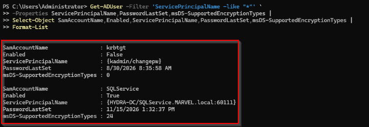
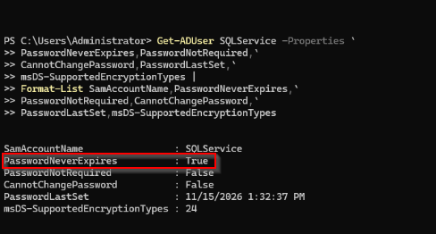
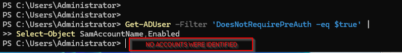
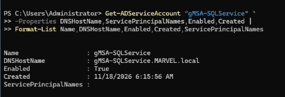
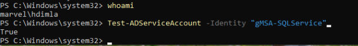

# Kerberos and Service Accounts (Checks 11–14)

## Overview

This section documents the Kerberos and service account security audit performed in the `MARVEL.LOCAL` Active Directory environment. The audit focused on Service Principal Names (SPNs), service account password security, AS-REP Roasting exposure, and the `krbtgt` account.

The purpose was to identify unnecessary privileged service accounts, review Kerberos configurations, and reduce risks associated with service account compromise.

---

## SPN Accounts Audit

### Objective

Identify accounts with Service Principal Names (SPNs) and review their enabled status, privilege level, and Kerberos encryption configuration.

### Initial Findings

The audit identified the following accounts:

| Account | Enabled | SPN | Encryption Types |
|---|---|---|---|
| SQLService | True | `HYDRA-DC/SQLService.MARVEL.local:60111` | 24 (AES128 + AES256) |
| krbtgt | False | `kadmin/changepw` | 0 (not explicitly configured) |



### SQLService Findings

The `SQLService` account was originally created for the Kerberoasting lab and was configured with an SPN. However, the account was also found to be a member of highly privileged groups:

- Domain Admins
- Enterprise Admins
- Schema Admins
- Administrators
- Group Policy Creator Owners

The account also contained a plaintext password in its Description attribute.

Although AES128 and AES256 were configured, the account remained a Kerberoasting target because it had an SPN. AES encryption does not eliminate Kerberoasting risk, making the strength and randomness of the service account password critical.

### Remediation

The account was retired because it was no longer needed.

Actions performed:

- Removed `SQLService` from privileged groups.
- Cleared the plaintext password from its Description attribute.
- Reset the account password to a strong random password.
- Checked Windows services for dependencies on the account.
- Checked scheduled tasks for dependencies on the account.
- Disabled the account.
- Removed its SPN.
- Cleared its `adminCount` value.
- Restored ACL inheritance.

### Final Verification

| Attribute | Final Value |
|---|---|
| Enabled | False |
| adminCount | 0 |
| Description | Empty |
| ServicePrincipalNames | Empty |
| MemberOf | Empty |
| ACL inheritance | Enabled |

The account was successfully retired and no longer serves as an active Kerberoasting target.

### krbtgt Observation

The `krbtgt` account was also inspected.

| Attribute | Value |
|---|---|
| Enabled | False |
| SPN | `kadmin/changepw` |
| Supported Encryption Types | 0 |
| PasswordLastSet | August 30, 2026 |

The disabled state of `krbtgt` is expected in this environment and was not treated as a security finding. An encryption type value of `0` indicates that no explicit encryption type was configured on the account; it does not independently prove that RC4 is being used.

---

## Service Account Password Security

### Objective

Review service account password settings, password expiration, password requirements, and password management practices.

### Findings

The original `SQLService` account was manually managed and had the following settings:

| Setting | Value |
|---|---|
| PasswordNeverExpires | True |
| PasswordNotRequired | False |
| CannotChangePassword | False |
| PasswordLastSet | September 3, 2026 (initial audit) |

The account's password was not required to be exempt from password expiration, but `PasswordNeverExpires` was enabled, creating a long-term credential management concern.



### Domain Password Policy

The default domain password policy was inspected.

| Policy | Value |
|---|---|
| Maximum Password Age | 42 days |
| Minimum Password Age | 1 day |
| Password History | 24 passwords |

No resultant fine-grained password policy was returned for `SQLService`, indicating that the default domain password policy applied during the audit.

### Remediation

The old `SQLService` account was retired instead of continuing manual password management.

A Group Managed Service Account (gMSA) was created as a managed-account alternative.

---

## AS-REP Roasting

### Objective

Identify enabled accounts that do not require Kerberos pre-authentication and may be vulnerable to AS-REP Roasting.

### Audit Command

```powershell
Get-ADUser -Filter 'DoesNotRequirePreAuth -eq $true' |
Select-Object SamAccountName,Enabled
```



### Findings

The command returned no accounts.

No accounts were identified with `DoesNotRequirePreAuth` set to `True` during this audit.

### Status

No accounts were identified as exposed to AS-REP Roasting by this check.

---

## krbtgt Account Audit

### Objective

Review the domain `krbtgt` account's status, password configuration, and Kerberos-related attributes.

### Findings

The following configuration was verified:

| Attribute | Value |
|---|---|
| SamAccountName | krbtgt |
| Enabled | False |
| PasswordNeverExpires | False |
| DoesNotRequirePreAuth | False |
| SPN | `kadmin/changepw` |
| PasswordLastSet | August 30, 2026 |

The `krbtgt` account was disabled. This is expected in the environment and was not treated as a misconfiguration requiring remediation.

The account's password expiration setting was also reviewed. `krbtgt` password rotation remains an important Active Directory maintenance practice because this account is critical to Kerberos authentication and the issuance of Ticket Granting Tickets (TGTs).

### Assessment

No remediation was required for the account's disabled status or pre-authentication configuration.

Password rotation should be performed according to an appropriate domain maintenance procedure. A `krbtgt` password reset should not be performed casually because it can affect Kerberos authentication and existing tickets.

---

## gMSA Implementation and Validation

As an alternative to the retired manually managed service account, a Group Managed Service Account was created.

### gMSA Details

| Attribute | Value |
|---|---|
| Account Name | `gMSA-SQLService` |
| DNS Hostname | `gMSA-SQLService.MARVEL.local` |
| Enabled | True |
| Authorized Retrieval Group | `gMSA-SQLService-Hosts` |
| Authorized Host | `HEAVEN` |



### Implementation

A dedicated security group was created to control which computers are allowed to retrieve the gMSA managed password.

The `HEAVEN` computer account was added to this group, and the gMSA was configured to allow password retrieval by authorized members.

A KDS Root Key was also established in the lab to support gMSA password generation.

### Validation

The gMSA was installed and tested on the `HEAVEN` domain-joined workstation.

```powershell
Install-ADServiceAccount -Identity "gMSA-SQLService"

Test-ADServiceAccount -Identity "gMSA-SQLService"
```

The test returned:

```text
True
```



This confirmed that `HEAVEN` was able to successfully retrieve and use the gMSA managed password.

**Note:** The gMSA has been created and validated, but an actual Windows service or application has not yet been migrated to use it. It is therefore considered a validated replacement candidate, not a completed service migration.

---

## Final Audit Summary

| Finding | Status |
|---|---|
| SPN Accounts | Privileged `SQLService` account with SPN identified and retired | Remediated |
| Service Account Passwords | Manual service account management risk addressed by retiring `SQLService` and validating gMSA | Remediated |
| AS-REP Roasting | No accounts identified with pre-authentication disabled | Passed |
| krbtgt | Disabled account state verified as expected | Passed |

## Conclusion

The Kerberos and service account audit identified an unnecessarily privileged service account with an SPN and insecure credential storage practices.

The `SQLService` account was fully retired by removing its privileged memberships, clearing exposed credentials, disabling the account, removing its SPN, clearing its protected-account marker, and restoring ACL inheritance.

A gMSA was implemented and successfully validated on an authorized domain-joined workstation, demonstrating a safer managed credential approach for future service deployment.

The audit also confirmed that no accounts were identified as vulnerable to AS-REP Roasting by the performed check, and the `krbtgt` account's disabled status was consistent with the expected configuration.

These changes reduced unnecessary privileged account exposure and improved the service account security posture of the lab environment.
