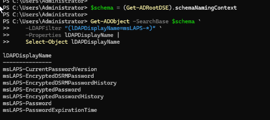
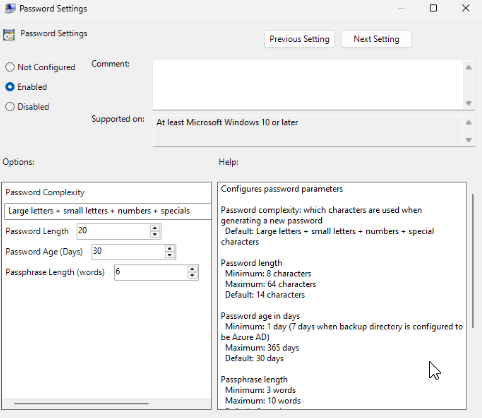
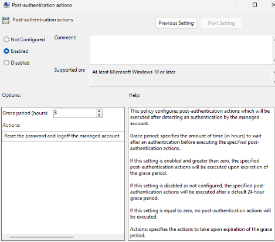
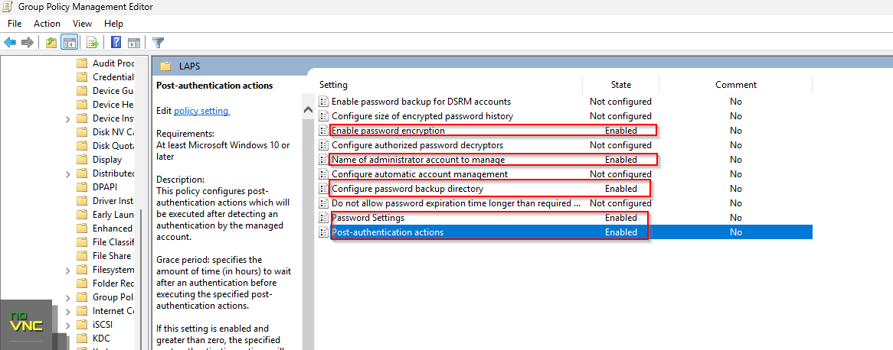
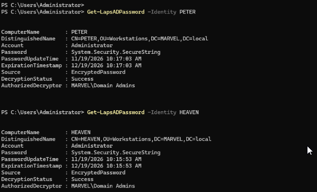
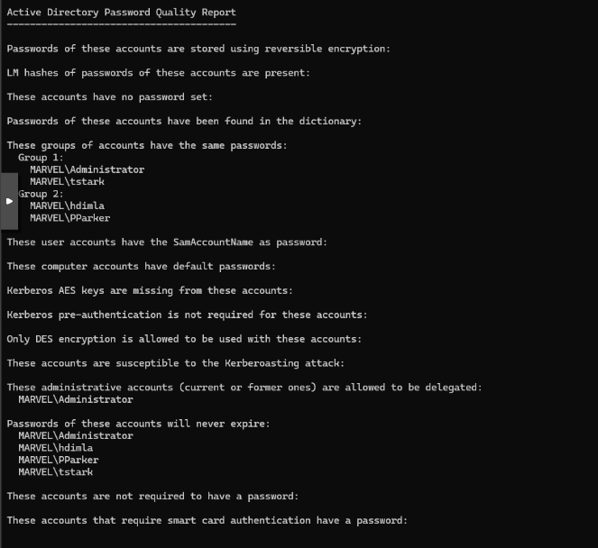
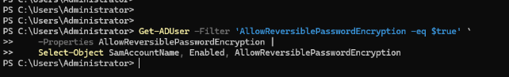
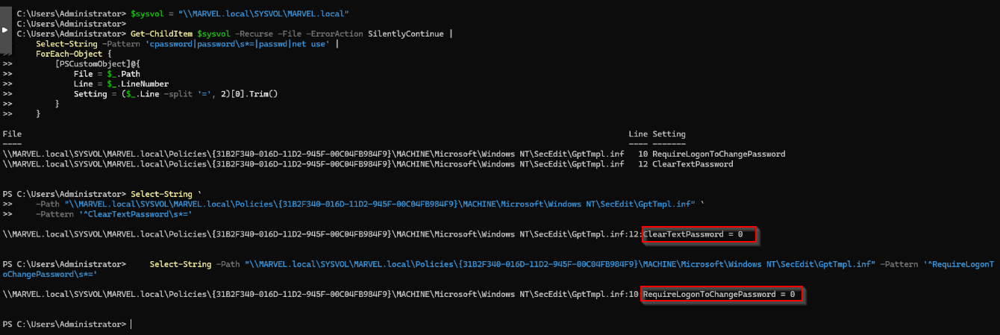

# Passwords, LAPS and the Password Audit

## Overview

This section covers password security and account hygiene in the `MARVEL.local` Active Directory environment.

The assessment focused on Windows LAPS, local administrator account management, password quality, password policy settings, SYSVOL credential exposure, inactive accounts, and the built-in Guest account.

---

## Windows LAPS

### Objective

Implement Windows Local Administrator Password Solution (Windows LAPS) to manage and automatically rotate local administrator passwords on domain-joined workstations.

### Initial Findings

- Windows LAPS PowerShell module was available.
- The Active Directory schema did not initially contain the Windows LAPS attributes.
- HEAVEN and PETER were located in `OU=Workstations`.
- No Windows LAPS policy had been configured.

### Remediation

**1. Updated the Active Directory Schema**

```powershell
Update-LapsADSchema
```



The following Windows LAPS attributes became available:

- `msLAPS-CurrentPasswordVersion`
- `msLAPS-EncryptedDSRMPassword`
- `msLAPS-EncryptedDSRMPasswordHistory`
- `msLAPS-EncryptedPassword`
- `msLAPS-EncryptedPasswordHistory`
- `msLAPS-Password`
- `msLAPS-PasswordExpirationTime`

**2. Granted Computer Self-Permissions**

```powershell
Set-LapsADComputerSelfPermission `
    -Identity "OU=Workstations,DC=MARVEL,DC=local"
```

This allows domain-joined computers in the OU to update their own LAPS password information in Active Directory.

**3. Reviewed Extended Rights**

```powershell
Find-LapsADExtendedRights `
    -Identity "OU=Workstations,DC=MARVEL,DC=local"
```

The returned principals were:

- `NT AUTHORITY\SYSTEM`
- `MARVEL\Domain Admins`
- `MARVEL\Enterprise Admins`
- `BUILTIN\Administrators`

No unexpected password readers were identified in the returned results.

**4. Created and Linked the GPO**

Created a Group Policy Object named:

`Windows LAPS Policy`

Linked it to:

`OU=Workstations,DC=MARVEL,DC=local`

Configured the following settings:

| Policy | Configuration |
|---|---|
| Configure password backup directory | Windows Server Active Directory |
| Enable password encryption | Enabled |
| Password complexity | Large + small letters, numbers, special characters |
| Password length | 20 characters |
| Password age | 30 days |
| Managed account | Built-in Administrator |
| Post-authentication actions | Reset password and log off managed account |
| Post-authentication grace period | 8 hours |







**5. Applied and Verified the Policy**

On PETER:

```powershell
gpresult /scope computer /r
```

The output confirmed that `Windows LAPS Policy` was applied.

Triggered policy processing:

```powershell
Invoke-LapsPolicyProcessing
```

Relevant Windows LAPS events included:

- Event ID 10009 – Configured to back up passwords to Active Directory.
- Event ID 10004 – Policy processing succeeded.
- Event ID 10020 – Local Administrator password successfully updated.
- Event ID 10018 – Password successfully updated in Active Directory.

**6. Verified Password Backup and Decryption**

On HYDRA-DC:

```powershell
Get-LapsADPassword -Identity PETER
Get-LapsADPassword -Identity HEAVEN
```



Both computers returned:

| Property | Result |
|---|---|
| Account | Administrator |
| Source | EncryptedPassword |
| DecryptionStatus | Success |
| AuthorizedDecryptor | MARVEL\Domain Admins |

### Final Assessment

Windows LAPS was successfully configured for HEAVEN and PETER. Both computers successfully rotated their built-in local Administrator passwords and backed up encrypted password data to Active Directory.

---

## Shared Local Administrator Passwords

### Objective

Reduce lateral movement risk caused by shared local administrator credentials and unnecessary local administrator privileges.

### Initial Findings

The built-in local Administrator accounts on HEAVEN and PETER were enabled.

Both computers had additional local accounts with administrative privileges:

- HEAVEN: `heaven`
- PETER: `Peter`

The custom local accounts were not managed by the configured Windows LAPS policy.

Both accounts had:
- `PasswordRequired = False`
- No configured password expiration
- Local Administrator group membership

### Remediation

The PETER local account was removed from the local Administrators group.

```cmd
net localgroup Administrators "PETER\Peter" /delete
```

This removed administrative group membership without deleting the local account.

### Verification

Checked the local Administrators group on PETER.

The resulting membership included:

- `MARVEL\Administrator`
- `MARVEL\Domain Admins`
- `MARVEL\hdimla`
- `MARVEL\PParker`
- `PETER\Administrator`

`PETER\Peter` was no longer listed.

The HEAVEN local account was left unchanged.

### Final Assessment

Windows LAPS now manages the built-in local Administrator account on both workstations. The PETER custom local account no longer has local administrative privileges.

The custom local accounts still exist and are not managed by the current LAPS policy.

---

## Active Directory Password Quality Audit

### Objective

Audit Active Directory password quality to identify weak, reused, breached, or improperly configured passwords.

### Tools

Installed and imported the DSInternals PowerShell module on HYDRA-DC.

```powershell
Install-Module DSInternals -Scope AllUsers -Repository PSGallery -Force

Import-Module DSInternals
```

### Audit Command

```powershell
$AuditResults = Get-ADReplAccount -All `
    -Server "HYDRA-DC.MARVEL.local" |
    Test-PasswordQuality

$AuditResults
```

### Initial Findings

The initial password audit identified:



**Accounts sharing identical passwords:**

- `MARVEL\Administrator`
- `MARVEL\tstark`

And:

- `MARVEL\hdimla`
- `MARVEL\PParker`

**Accounts with PasswordNeverExpires enabled:**

- `MARVEL\Administrator`
- `MARVEL\hdimla`
- `MARVEL\PParker`
- `MARVEL\tstark`

Additional findings included a delegation-related warning involving `MARVEL\Administrator`.

### Remediation

The following account passwords were changed:

- `tstark`
- `PParker`
- `hdimla`

The domain Administrator password was also targeted for rotation.

Password expiration settings were addressed for the accounts identified by the audit, including the built-in Guest and retired SQLService accounts.

The delegation-related finding was also addressed through the account-not-delegated setting.

### Final Assessment

The initial audit identified password reuse and account configuration issues. Remediation actions were performed.

---

## Password Not Required

### Objective

Identify Active Directory accounts that do not require a password.

### Initial Findings

Executed:

```powershell
Get-ADUser -Filter 'PasswordNotRequired -eq $true' `
    -Properties PasswordNotRequired |
    Select-Object SamAccountName, Enabled, PasswordNotRequired
```


The initial result identified:

| Account | Enabled | PasswordNotRequired |
|---|---|---|
| Guest | False | True |

### Remediation

Updated the Guest account:

```powershell
Set-ADUser -Identity "Guest" -PasswordNotRequired $false
```

### Verification


Reran the original query. No accounts were returned.

### Final Assessment

No Active Directory user accounts were found with `PasswordNotRequired` enabled.

---

## Reversible Password Encryption

### Objective

Identify accounts configured to store passwords using reversible encryption.



### Verification

Executed:

```powershell
Get-ADUser -Filter 'AllowReversiblePasswordEncryption -eq $true' `
    -Properties AllowReversiblePasswordEncryption |
    Select-Object SamAccountName, Enabled, AllowReversiblePasswordEncryption
```

### Results

No accounts were returned.

### Final Assessment

No Active Directory user accounts were found with reversible password encryption enabled.

---

## SYSVOL Credential Exposure

### Objective

Search SYSVOL for Group Policy Preferences credentials, plaintext passwords, and potentially exposed credentials in scripts or policy files.

### Audit Command

```powershell
$sysvol = "\\MARVEL.local\SYSVOL\MARVEL.local"

Get-ChildItem $sysvol -Recurse -File -ErrorAction SilentlyContinue |
    Select-String -Pattern 'cpassword|password\s*=|passwd|net use' |
    ForEach-Object {
        [PSCustomObject]@{
            File = $_.Path
            Line = $_.LineNumber
            Setting = ($_.Line -split '=', 2)[0].Trim()
        }
    }
```



### Initial Findings

The scan returned two matches in the Default Domain Policy:

`MACHINE\Microsoft\Windows NT\SecEdit\GptTmpl.inf`

| Line | Setting |
|---|---|
| 10 | RequireLogonToChangePassword |
| 12 | ClearTextPassword |

These were security policy settings, not exposed credentials.

### Verification

Checked the reversible password storage setting:

```powershell
Select-String `
    -Path "\\MARVEL.local\SYSVOL\MARVEL.local\Policies\{31B2F340-016D-11D2-945F-00C04FB984F9}\MACHINE\Microsoft\Windows NT\SecEdit\GptTmpl.inf" `
    -Pattern '^ClearTextPassword\s*='
```

Result:

```text
ClearTextPassword = 0
```

### Final Assessment

The Default Domain Policy has reversible password storage disabled. The SYSVOL scan did not identify `cpassword` entries or plaintext credential matches. The two returned matches were policy settings.

---

## Inactive Active Directory Accounts

### Objective

Identify user and computer accounts that have been inactive for 90 days or more.

### User Account Audit

Executed:

```powershell
Search-ADAccount -AccountInactive -TimeSpan 90.00:00:00 -UsersOnly |
    Get-ADUser -Properties LastLogonDate, Enabled, Description |
    Select-Object SamAccountName, Enabled, LastLogonDate, Description
```

### Findings

The following accounts were returned:

| Account | Enabled | Description |
|---|---|---|
| Guest | False | Built-in account for guest access to the computer/domain |
| krbtgt | False | Key Distribution Center Service Account |
| SQLService | False | No description |

All returned accounts were already disabled.

### Computer Account Audit

Executed:

```powershell
Search-ADAccount -AccountInactive -TimeSpan 90.00:00:00 -ComputersOnly |
    Get-ADComputer -Properties LastLogonDate, Enabled |
    Select-Object Name, Enabled, LastLogonDate
```

### Results

No computer accounts were returned.

### Final Assessment

No additional active stale user or computer accounts were identified for disabling based on the audit results.

---

## Built-in Guest Account Disabled

### Objective

Ensure the built-in Active Directory Guest account is disabled to prevent unauthorized guest access.

### Verification

Executed:

```powershell
Get-ADUser -Identity "Guest" |
    Select-Object SamAccountName, Enabled, SID
```

### Results

| Property | Result |
|---|---|
| SamAccountName | Guest |
| Enabled | False |
| SID | Ends in `-501` |

The SID ending in `-501` identifies the built-in Guest account.

### Final Assessment

The built-in Guest account is disabled.

---

## Overall Summary

| Check | Status |
|---|---|
| Windows LAPS | Passed |
| Shared Local Administrator Passwords | Passed |
| Password Quality Audit | Passed |
| Password Not Required | Passed |
| Reversible Password Encryption | Passed |
| SYSVOL Credential Exposure | Passed |
| Inactive AD Accounts | Passed |
| Built-in Guest Account Disabled | Passed |

### Conclusion

The assessment improved local administrator password management through Windows LAPS, reduced unnecessary local administrative privileges on PETER, and reviewed password-related account settings across the `MARVEL.local` domain.

The audit also identified password reuse and account configuration issues that required remediation. The SYSVOL scan found no exposed Group Policy Preferences credentials, and no additional active stale accounts were identified.
