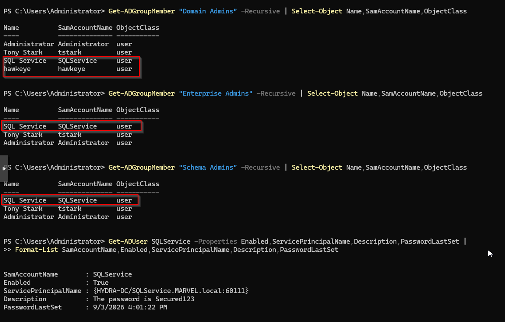
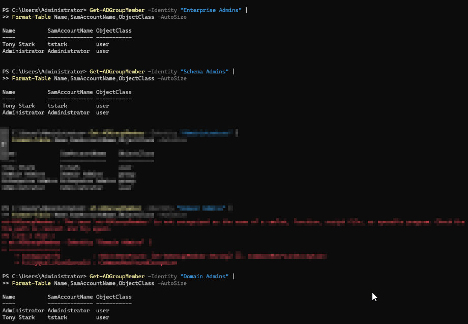
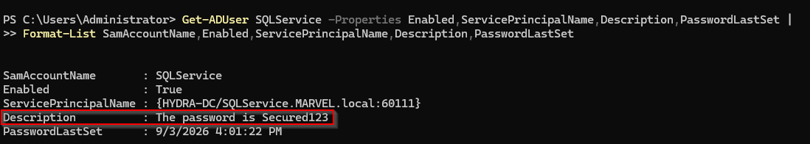
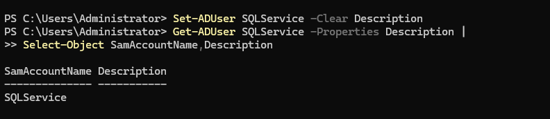
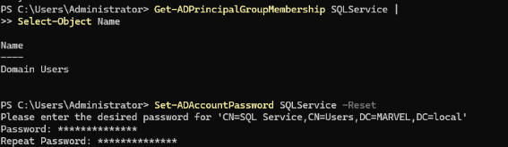
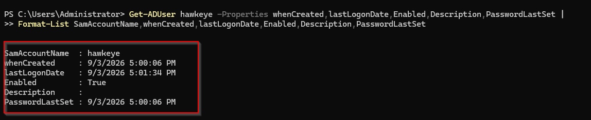
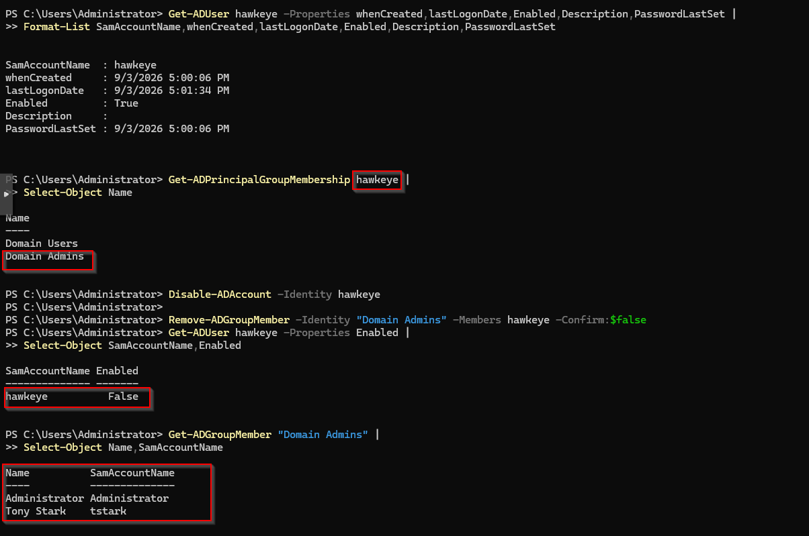
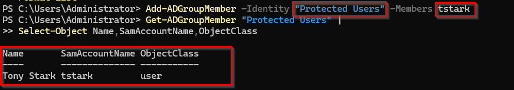
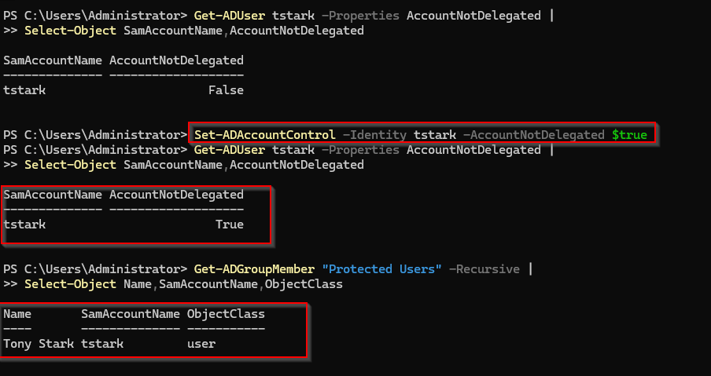
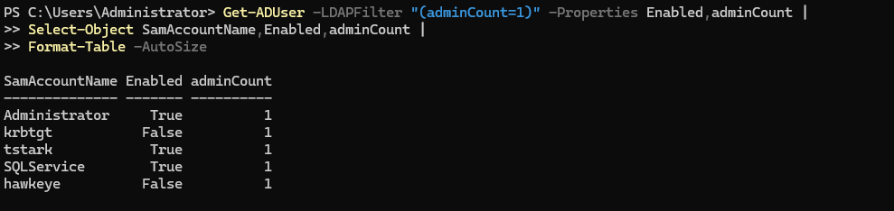

# Tier 0 Account and Active Directory Permissions Audit

## 1. Overview

This documentation covers the security assessment and hardening of Tier 0 accounts and Active Directory permissions within the `MARVEL.LOCAL` domain.

The assessment focused on identifying excessive administrative privileges, reviewing privileged group memberships, inspecting access control permissions, and addressing security issues involving the `SQLService` and `hawkeye` accounts.

It also documents the initial configurations, remediation activities, post-remediation verification, and remaining security concerns.

### Environment

| Component | Configuration |
|---|---|
| Domain | `MARVEL.LOCAL` |
| Domain Controller | `HYDRA-DC` |
| Domain Functional Level | Windows Server 2025 |
| Audit Scope | Tier 0 accounts and Active Directory permissions |

### Objectives

- Identify excessive privileged group memberships.
- Review privileged and service accounts.
- Investigate suspicious or unnecessary administrative accounts.
- Review Protected Users and delegation configurations.
- Inspect user-object and OU permissions.
- Identify accounts or groups with DCSync-related permissions.
- Document security remediation and verification results.

---

## 2. Initial Privileged Group Membership Review

The initial recursive group membership checks identified several accounts with elevated administrative privileges.

### 2.1 Before Remediation

The following results were collected using `Get-ADGroupMember -Recursive`.

**Domain Admins**

| Account | Object Class |
|---|---|
| Administrator | user |
| tstark | user |
| SQLService | user |
| hawkeye | user |

**Enterprise Admins**

| Account | Object Class |
|---|---|
| SQLService | user |
| tstark | user |
| Administrator | user |

**Schema Admins**

| Account | Object Class |
|---|---|
| SQLService | user |
| tstark | user |
| Administrator | user |



### Initial Findings

- `SQLService` was a member of Domain Admins, Enterprise Admins, and Schema Admins.
- `hawkeye` was a member of Domain Admins.
- `Administrator` and `tstark` were members of all three privileged groups.
- The SQLService account had administrative privileges far beyond what a typical service account requires.

These memberships increased the potential impact of account compromise.

### 2.2 After Remediation

The elevated memberships of SQLService and hawkeye were addressed.

The verified post-remediation membership state was:

| Account | Domain Admins | Enterprise Admins | Schema Admins |
|---|---|---|---|
| Administrator | Member | Member | Member |
| tstark | Member | Member | Member |
| SQLService | Removed | Removed | Removed |
| hawkeye | Removed | Not listed | Not listed |

The `SQLService` account was also removed from its previously identified Administrators and Group Policy Creator Owners memberships.

Its latest verified group membership was `Domain Users` only.

The `hawkeye` account was removed from Domain Admins and retained in Domain Users.



**Assessment:** The excessive administrative group memberships identified on SQLService and hawkeye were addressed. Administrator and tstark remain privileged accounts and require strict access control.

---

## 3. SQLService Account Security Remediation

The `SQLService` account was created for the Kerberoasting lab. During the initial security assessment, excessive administrative privileges and exposed account information were discovered.

### 3.1 Before Remediation

The initial account configuration was inspected using:

```powershell
Get-ADUser SQLService -Properties Enabled,ServicePrincipalName,Description,PasswordLastSet |
Format-List SamAccountName,Enabled,ServicePrincipalName,Description,PasswordLastSet
```

The observed configuration was:

| Attribute | Initial Configuration |
|---|---|
| Account | SQLService |
| Enabled | True |
| Service Principal Name | `HYDRA-DC/SQLService.MARVEL.local:60111` |
| Description | Contained exposed plaintext password |
| PasswordLastSet | September 3, 2026 |
| Domain Admins | Member |
| Enterprise Admins | Member |
| Schema Admins | Member |
| Administrators | Previously identified as a member |
| Group Policy Creator Owners | Previously identified as a member |



### Security Findings

1. The account had membership in multiple highly privileged administrative groups.
2. The account had a configured Service Principal Name (SPN), making it relevant to the Kerberoasting lab.
3. The Description field contained plaintext password information.
4. The account was enabled despite having excessive administrative privileges.
5. The account had `adminCount=1`.
6. ACL inheritance was disabled.

The exposed password value is intentionally omitted from this documentation.

### 3.2 Remediation Performed

The following actions were completed:

1. Removed SQLService from Domain Admins.
2. Removed SQLService from Enterprise Admins.
3. Removed SQLService from Schema Admins.
4. Removed SQLService from Administrators.
5. Removed SQLService from Group Policy Creator Owners.
6. Cleared the exposed password information from the Description field.
   


7. Reset the SQLService account password.
   


8. Inspected Windows services and scheduled tasks on the Domain Controller and client systems for dependencies on the account.

### 3.3 After Remediation

The latest verified configuration was:

| Attribute | Before | After |
|---|---|---|
| Domain Admins | Member | Removed |
| Enterprise Admins | Member | Removed |
| Schema Admins | Member | Removed |
| Administrators | Member | Removed |
| Group Policy Creator Owners | Member | Removed |
| Domain Users | Membership | Only verified remaining group |
| Description | Exposed password information | Cleared |
| Password | Original password | Reset |
| Account Enabled | True | True |
| SPN | Configured | Retained for lab purpose |
| adminCount | 1 | 1 |
| ACL Inheritance | Disabled | Disabled |

### 3.4 Verification and Assessment

The latest group membership review confirmed that SQLService belonged only to Domain Users.

The account remained enabled for its intended lab purpose.

No Windows services or scheduled tasks using SQLService were found on the inspected Domain Controller and client systems.

However, this does not conclusively prove that no application, process, or external system depends on the account.

The `adminCount=1` value and disabled ACL inheritance remain subjects for further review.

**Assessment:** The excessive administrative memberships and exposed password information were addressed. The account retains its SPN for the lab, while application dependency validation and ACL review remain pending.

---

## 4. Hawkeye Account Investigation and Remediation

The `hawkeye` account was identified during the privileged account review. It was associated with the previous unauthorized administrative activity in the lab scenario.

### 4.1 Before Remediation

The account information was inspected using:

```powershell
Get-ADUser hawkeye -Properties whenCreated,lastLogonDate,Enabled,Description,PasswordLastSet |
Format-List SamAccountName,whenCreated,lastLogonDate,Enabled,Description,PasswordLastSet
```

Initial findings:

| Attribute | Initial Configuration |
|---|---|
| Account | hawkeye |
| Enabled | True |
| Domain Admins | Member |
| Created | September 3, 2026 |
| Last Logon | September 3, 2026 |
| adminCount | 1 |
| ACL Inheritance | Disabled |



### Security Findings

- The account had Domain Admins membership.
- The account was enabled.
- The recorded creation and last logon dates were September 3, 2026.
- The account had administrative-related metadata and ACL inheritance was disabled.

### 4.2 Remediation Performed

The following actions were completed:

1. Disabled the hawkeye account.
2. Removed the account from Domain Admins.
3. Preserved the account for further investigation instead of deleting it.

### 4.3 After Remediation

| Attribute | Before | After |
|---|---|---|
| Domain Admins | Member | Removed |
| Domain Users | Membership | Only verified remaining group |
| Account Enabled | True | False |
| Created | September 3, 2026 | Unchanged |
| Last Logon | September 3, 2026 | Historical value |
| adminCount | 1 | 1 |
| ACL Inheritance | Disabled | Disabled |



### 4.4 Verification and Assessment

The account was verified as disabled and no longer a member of Domain Admins.

It was preserved as potential investigation evidence.

Recommended follow-up investigation includes reviewing:

- Security Event ID `4720` – User account creation.
- Security Event ID `4728` – Member added to a global security group.
- Security Event ID `4732` – Member added to a local security group.

These events should be investigated around September 3, 2026, if the relevant logs are still available.

**Assessment:** The immediate administrative access risk was addressed by disabling hawkeye and removing its Domain Admins membership. Historical activity still requires investigation.

---

## 5. Protected Users and Delegation Configuration

The privileged account `tstark` was added to the built-in Protected Users security group.

### 5.1 Protected Users Verification

Command:

```powershell
Get-ADGroupMember "Protected Users" |
Select-Object Name,SamAccountName
```

Observed result:

```text
Name       SamAccountName
Tony Stark tstark
```



### 5.2 Delegation Verification

The account's delegation setting was checked using:

```powershell
Get-ADUser tstark -Properties AccountNotDelegated |
Select-Object SamAccountName,AccountNotDelegated
```

Observed result:

```text
SamAccountName AccountNotDelegated
tstark         True
```


### 5.3 Kerberos Verification

The account was tested from a domain-joined client using:

```powershell
klist
```

Previously observed results:

- TGT encryption: AES-256
- TGT lifetime: 4 hours
- KDC: `HYDRA-DC.MARVEL.local`

### Assessment

The account is a member of Protected Users and has `AccountNotDelegated=True`.

Protected Users provides additional authentication protections, including restrictions on NTLM, weaker Kerberos encryption, delegation, and TGT lifetime.

The observed Kerberos ticket properties do not independently prove that every Protected Users restriction is enforced in all authentication scenarios. Compatibility testing remains important.

Service accounts and computer accounts should not be added to Protected Users without careful compatibility assessment.

---

## 6. Accounts with adminCount=1

The following accounts were returned by:

```powershell
Get-ADUser -LDAPFilter "(adminCount=1)" -Properties Enabled,adminCount |
Select-Object SamAccountName,Enabled,adminCount
```

### Results

| Account | Enabled | adminCount |
|---|---|---|
| Administrator | True | 1 |
| krbtgt | False | 1 |
| tstark | True | 1 |
| SQLService | True | 1 |
| hawkeye | False | 1 |



### Findings

- Administrator and tstark are enabled privileged accounts.
- SQLService remains enabled but has been removed from its previously identified elevated groups.
- hawkeye is disabled and has been removed from Domain Admins.
- krbtgt was reported as disabled and requires investigation.

**Important:** The disabled state of krbtgt should not be assumed to be normal. Its account state and authentication impact must be investigated before making changes.

`adminCount=1` is not proof of current privileged group membership. It can remain after an account has been removed from protected administrative groups.

Both SQLService and hawkeye were also found to have ACL inheritance disabled.

**Recommendation:** Do not clear `adminCount` or re-enable inheritance without reviewing the object's permissions and intended administrative status.

---

## 7. User Object Permissions Review

User-object ACLs were inspected for:

- WriteDACL
- Reset Password

### 7.1 WriteDACL Findings

The following principals appeared in the inspected user-object ACLs:

- `NT AUTHORITY\SYSTEM`
- `BUILTIN\Administrators`
- `MARVEL\Domain Admins`
- `MARVEL\Enterprise Admins`
- `BUILTIN\Account Operators` on selected accounts

The Account Operators group currently has no direct members.

### 7.2 Reset Password Findings

The scan used the Reset Password extended-right GUID:

```text
00299570-246d-11d0-a768-00aa006e0529
```

No matching ACEs were identified on the individual user objects examined.

### Assessment

No unexpected Reset Password ACE was identified in the scanned user objects.

**Limitation:** This check does not establish that no password-reset delegation exists elsewhere in Active Directory. Other object types and delegation paths require separate review.

---

## 8. Organizational Unit Permissions Review

The following OUs were inspected:

- Domain Controllers
- Groups
- Workstations

### 8.1 WriteDACL

The following principals were identified:

- `NT AUTHORITY\SYSTEM`
- `MARVEL\Domain Admins`
- `MARVEL\Enterprise Admins`
- `BUILTIN\Administrators`

No unexpected principal was identified in the inspected OU ACLs.

### 8.2 GenericAll

The corrected exact-permission check identified:

| OU | Principal |
|---|---|
| Domain Controllers | NT AUTHORITY\SYSTEM |
| Domain Controllers | MARVEL\Enterprise Admins |
| Groups | NT AUTHORITY\SYSTEM |
| Groups | MARVEL\Domain Admins |
| Groups | MARVEL\Enterprise Admins |
| Workstations | NT AUTHORITY\SYSTEM |
| Workstations | MARVEL\Domain Admins |
| Workstations | MARVEL\Enterprise Admins |

No unexpected principal was identified with an exact GenericAll Allow ACE.

### 8.3 WriteProperty

The three OUs were inspected for WriteProperty permissions.

Observed entries included:

- SYSTEM
- Domain Admins
- Enterprise Admins
- Key Admins
- Enterprise Key Admins
- SELF
- BUILTIN\Administrators

The Key Admins and Enterprise Key Admins entries were inherited attribute-level permissions.

Some entries contained specific ObjectType GUIDs that were not fully mapped during this audit. These permissions should not be removed without understanding their associated object types and intended purposes.

### 8.4 Reset Password

The OU ACL scan returned no matching Reset Password extended-right ACEs.

**Limitation:** These checks cover the inspected OU ACLs, not every AD object or every possible delegated permission path.

---

## 9. Domain-Level DCSync Permissions Review

The domain root ACL was inspected for replication-related extended rights.

### 9.1 Important Extended Rights

| GUID | Permission |
|---|---|
| `1131f6aa-9c07-11d1-f79c-00c04fc2dcd2` | Replicating Directory Changes |
| `1131f6ad-9c07-11d1-f79c-00c04fc2dcd2` | Replicating Directory Changes All |
| `89e95b76-444d-4c62-991a-0facbeda640c` | Replicating Directory Changes In Filtered Set |

### 9.2 Findings

The domain-root ACL returned the following relevant entries:

| Principal | Permission |
|---|---|
| BUILTIN\Administrators | Replicating Directory Changes |
| BUILTIN\Administrators | Replicating Directory Changes All |
| BUILTIN\Administrators | Replicating Directory Changes In Filtered Set |
| MARVEL\Domain Controllers | Replicating Directory Changes All |
| NT AUTHORITY\ENTERPRISE DOMAIN CONTROLLERS | Replicating Directory Changes |
| NT AUTHORITY\ENTERPRISE DOMAIN CONTROLLERS | Replicating Directory Changes In Filtered Set |
| MARVEL\Enterprise Read-only Domain Controllers | Replicating Directory Changes |

### 9.3 Assessment

`BUILTIN\Administrators` has the replication permissions associated with DCSync capability.

Its current membership includes:

- Administrator
- tstark
- Domain Admins
- Enterprise Admins

Therefore, these privileged accounts have access to DCSync-level permissions through their administrative group membership.

The replication permissions assigned to domain controller groups are part of the inspected AD replication configuration and should not be removed without understanding their impact.

No ordinary user account was identified with the two key replication rights in the inspected domain-root ACL.

**Important:** DCSync-level permissions provide highly sensitive access to domain credential data. Strict control of the Administrators group's membership is essential.

---

## 10. Overall Security Findings and Remediation Summary

| Security Area | Initial Finding | Remediation / Current State |
|---|---|---|
| SQLService Domain Admins | Member | Removed |
| SQLService Enterprise Admins | Member | Removed |
| SQLService Schema Admins | Member | Removed |
| SQLService Administrators | Member | Removed |
| SQLService Group Policy Creator Owners | Member | Removed |
| SQLService Description | Exposed password information | Cleared |
| SQLService Password | Original password | Reset |
| SQLService Account | Enabled | Still enabled |
| SQLService SPN | Configured | Retained for lab purpose |
| hawkeye Domain Admins | Member | Removed |
| hawkeye Account | Enabled | Disabled |
| hawkeye Investigation | Account identified | Preserved for investigation |
| tstark Protected Users | Not configured | Membership verified |
| tstark Delegation | Reviewed | AccountNotDelegated=True |
| Account Operators | Reviewed | Empty |
| adminCount=1 | Five accounts identified | Reviewed; remaining investigation required |
| User-object WriteDACL | Inspected | Reviewed |
| User-object Reset Password | Inspected | No matches in scanned objects |
| OU WriteDACL | Inspected | No unexpected principal identified |
| OU GenericAll | Inspected | No unexpected principal identified |
| OU WriteProperty | Inspected | Special-purpose entries require further review |
| OU Reset Password | Inspected | No matches in scanned OUs |
| Domain-root DCSync | Replication rights identified | Administrators confirmed to have required rights |

---


## 11. Conclusion

The Tier 0 account and Active Directory permissions audit identified excessive administrative privileges on the SQLService account and an enabled hawkeye account with Domain Admins membership.

Remediation was performed by removing SQLService from elevated administrative groups, clearing exposed password information, and resetting its password. The hawkeye account was disabled and removed from Domain Admins while being preserved for further investigation.

Additional security reviews covered privileged group membership, Protected Users configuration, delegation settings, user-object permissions, OU permissions, and domain-level DCSync rights.

The audit confirmed that `BUILTIN\Administrators` has the replication permissions associated with DCSync capability, making strict administrative group membership control essential.

Although several security issues were addressed, additional validation remains necessary, particularly for `adminCount=1`, ACL inheritance, the disabled krbtgt account, and historical hawkeye activity.

**Audit Status:** Initial Tier 0 audit and selected account remediations completed. Further investigation, validation, and hardening remain in progress.
